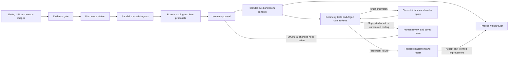

# Listing2Living

**Paste a listing. Step inside. Make it yours.**

Listing2Living turns a property's floor plan and photos into an editable 3D planning scene. Gemini 4 Argon reads the evidence, proposes furnishings, and critiques the rendered result. A person approves the proposed items before Blender builds them. Geometry tools test circulation and collisions; proposed repairs are tested again before acceptance.

The worked example is **200 Brannan Street, Apt 114, San Francisco**: two floors, 13 modeled rooms/areas, an editable floor plan, and an explorable reconstruction. Its architectural footprint was traced from the source plan. Additional Zillow URLs go through a live evidence gate and a separate, source-generated shell. Passing intake permits a reconstruction attempt; it does not certify the resulting geometry or appearance.


**[Watch the 3-minute demo](https://youtu.be/yrOrQbBV7ko)** · [60-second submission](https://youtu.be/82tADq7ukXI) · **[Visual walkthrough](docs/BRANNAN-WALKTHROUGH.md)** · **[Architecture and agent orchestration](docs/ARCHITECTURE.md)** · [Live judging guide](docs/DEMO.md)

### The moment to watch

A deliberately placed bench blocks the doorway. The geometry check fails. Argon proposes a placement repair; the harness tests it and can use a bounded geometric placement search if needed. It accepts an improvement only when previously reachable destinations remain reachable. In the recorded Brannan run, all nine destinations become reachable again.

| Deliberate obstruction — revision 29                                                  | Verified repair — revision 30                                                                                   |
| ------------------------------------------------------------------------------------- | --------------------------------------------------------------------------------------------------------------- |
|  |  |

These are screenshots from an actual prepared demo run. Clear routes establish the result of the geometric check; they do not establish visual similarity to the listing.

## From evidence to a space you can test

Every stage has a visual example in the [Brannan walkthrough](docs/BRANNAN-WALKTHROUGH.md). The [architecture guide](docs/ARCHITECTURE.md) explains each stage's inputs, outputs, gates and implementation.



| Stage                 | What happens in the Brannan example                                                                               | Evidence produced                                                      |
| --------------------- | ----------------------------------------------------------------------------------------------------------------- | ---------------------------------------------------------------------- |
| 1. Check sources      | Identify this property's photos and a readable dimensioned floor plan.                                            | Intake report, source IDs and uncertainty.                             |
| 2. Interpret the plan | Read printed measurements and interpret the declared source-traced two-floor seed.                                | Room interpretation in metres, with inferred dimensions labelled.      |
| 3. Run specialists    | Item, structure, openings/stairs and material roles run concurrently; photos are then mapped to individual rooms. | Item proposals, structural findings, finishes and photo-to-room links. |
| 4. Ask the person     | Review the rooms, choose furnishings and adjust estimated sizes.                                                  | Explicit approval before Blender generation.                           |
| 5. Build and explore  | Blender builds the architecture and renders rooms; Three.js provides the interactive scene and movable furniture. | Architectural GLB, room renders and shared scene data.                 |
| 6. Test               | Check object boundaries, collisions and circulation on both floors.                                               | Pass/fail findings and nine navigation destinations in this demo.      |
| 7. Repair and retest  | Propose a change, run the checks again and accept only a verified improvement.                                    | Before/after checks, bounded attempts and an undoable scene revision.  |
| 8. Compare each room  | Argon compares each actual room render with matched source photos and the plan when available.                    | Revision-linked findings; missing evidence remains explicit.           |
| 9. Keep the work      | Save each property's scene, source mapping, approvals and artifacts separately.                                   | Independent saved homes and archived build snapshots.                  |

## How the agent harness works

The harness is the application's **TypeScript orchestration layer**. It assigns focused roles to real `gemini-4-argon` requests, passes images and structured scene context, validates responses, schedules parallel workers, invokes tools, and records progress. These roles share a model; they are separate bounded calls coordinated by our code, not persistent autonomous services or the Managed Agents product.

- **Argon supplies judgments and proposals:** evidence classification, plan interpretation, room/photo matching, furniture analysis, material descriptions, repair proposals and rendered-room critique.
- **The application controls execution:** typed contracts, ordering, human approval, bounded concurrency, retries, immutable build paths, snapshots and rollback.
- **Deterministic tools establish geometry results:** Blender constructs and renders; shared geometry code checks collisions and routes. A model's claim that a repair worked is insufficient on its own.
- **The person resolves uncertainty:** absent photographs and structural discrepancies cannot be cleared by optimistic scores.

Read the [full architecture](docs/ARCHITECTURE.md) for the orchestration graph, repair loops, scene contract, persistence layout and source-code map.

## Both floors, with room-level accountability


The recorded visual review of revision 28 found **2 of 13 rooms** above the provisional threshold, **9 needing refinement**, and **2 lacking direct photos**. The route-repaired revision 30 is newer, so the UI marks that review stale. We show those limitations rather than presenting a route pass as a fully verified reconstruction.

## Run locally

Requirements: Node.js 22+, Python 3.11+, Blender 5.x, and a Gemini API key with access to `gemini-4-argon`.

```powershell
npm ci
Copy-Item .env.example .env
# Set GEMINI_API_KEY in the local .env file.
npm run dev
```

Open [the local studio](http://127.0.0.1:5173). The key is used only by the local server. `.env`, downloaded source images, model interactions, and generated artifacts are excluded from Git.

The default Blender path is `C:\Program Files\Blender Foundation\Blender 5.0\blender.exe`; set `BLENDER_PATH` if yours differs. The builder can use the installed Blender MCP add-on on localhost 9876 or fall back to a Blender subprocess. See [Blender setup](blender/README.md).

## The flow

1. **Check the listing:** inspect actual image bytes, identify a readable floor plan with printed dimensions/scale, and require at least three interior photos. Only the requested property's structured gallery is used; nearby properties are excluded. The current home stays open while this runs.
2. **Interpret the plan:** normalize dimensions, room polygons, openings, stairs, coordinate conventions, and uncertainty for the 3D builder.
3. **Map room evidence and propose items:** Argon links photos to rooms, estimates source-consistent wall/floor/ceiling finishes, identifies supported furnishings, and records uncertainty. Suggested additions are labelled separately. Rooms without photos retain explicitly inferred finishes.
4. **Approve:** select items and adjust estimated dimensions, or use three suggested pieces.
5. **Build and test:** Blender assembles both floors. Geometry checks test collisions, boundaries, downstairs routes and upstairs routes from the landing.
6. **Render every room:** Blender produces a separate interior image for each room. Argon compares that image with the room's matched source photos and returns similarity scores, concrete differences, and recommendations. Missing photos or renders cannot pass.
7. **Repair and recheck:** bounded attempts handle movable placements or source-based room finishes. A finish correction is accepted only after fresh renders improve the material assessment without losing a previously passing room. Structural questions and missing evidence remain for a person to review.
8. **Keep each home:** scenes, approval state, sources, interactions, room reviews and generated builds are isolated by property. Use the saved-home menu to return to a previous home. A repeated build archives its earlier scene; published build assets are immutable.

The browser uses Three.js for interaction and procedural furniture, with a Blender-exported architectural GLB. The canonical scene uses metres, XY ground coordinates and Z up, so the plan, renderer, builder and checks share the same object IDs and dimensions.

## Try the demo

Use this [Brannan listing](https://www.zillow.com/homedetails/200-Brannan-St-APT-114-San-Francisco-CA-94107/69817820_zpid/), then review the proposed items. In the finished scene:

- Compare source photos with the reconstruction.
- Open **Sources** to see room-specific reference/render pairs, missing evidence, stale reviews, and finish refinement.
- Use **Check a listing**, then **Build from these sources** only when the evidence gate passes. Changing the URL does not replace the open home until a new build starts.
- Switch between Main floor and Second floor; the plan and furniture tools follow the selected level.
- Choose **Walk inside**: W/S move forward/back, A/D strafe, left/right arrows turn, up/down arrows look, and mouse-drag looks around. Walk onto the stairs to move between floors. Escape returns to orbit controls.
- Ask for a sofa and a work desk while keeping the kitchen and stairs reachable.
- Select furniture on the floor plan and move, rotate or recolor it.
- Turn on clear routes and rehearse a walk through.
- Add the explicitly labelled doorway stress test, then run Repair.
- Inspect the current browser view with Argon and review its recommendations.

See the [illustrated Brannan walkthrough](docs/BRANNAN-WALKTHROUGH.md), [architecture guide](docs/ARCHITECTURE.md), [V1 implementation plan](docs/V1-PLAN.md) and [three-minute demo guide](docs/DEMO.md).

## Checks

```powershell
npm run typecheck
npm test
npm run build
node scripts/check-argon.mjs
```

The final command makes a small real API request. Application requests also use the real `gemini-4-argon` model; there is no silent fallback to a different model.

## Scope and evidence

- The intake adapter supports HTTPS Zillow property URLs, not arbitrary websites/search pages. Blocked pages stop unless a labelled reference set for that exact property is available. The Brannan demo has a curated fallback; other properties do not silently borrow it.
- The footprint comes from a source-traced floor plan. Ceiling height, furniture dimensions and some details are estimates. The listing and plan disagree about total area; the application preserves that disagreement.
- The Brannan reference set includes 22 interior photographs and 3 floor-plan references, mapping photos to 11 of 13 rooms. Entry and linen closets lack direct photos and cannot pass visual similarity review. Upstairs floor height, vertical alignment, fixture sizes and exact placements remain inferred. The east-bedroom source suggests a level change that the current shell does not reproduce; reviewers must retain that difference.
- A route result is a geometric planning check with a configured clearance, not a building-code or accessibility certification.
- Visual scores are an uncalibrated model rubric, not a measured percentage of realism or accuracy. Unresolved findings and stale scene revisions remain visible.
- Repairs preserve fixed architecture and approved furniture sizes. Structural changes require renewed human review. Automatic attempts are capped.
- Source photos belong to their respective rights holders and are referenced by URL, not redistributed in the repository. Public availability does not establish permission to republish them. Obtain the needed permission for submitted demo footage, or use owned/authorized replacement imagery.
- Procedural meshes, interface, orchestration and verification code are the project's contributions. Existing libraries, Blender, and the source property are not claimed as original work.

This is a local prototype: the browser and server run on the demonstration machine. No hosted deployment is implied.

## Saved homes

`runtime/projects/<property-id>/state.json` stores each scene, workflow and undo history; `versions/` preserves prior build snapshots and `interactions/` stores that property's model responses. Source images live under `public/evidence/<property-id>/`; each Blender run publishes to a unique `public/generated/<scene-id>/build-<revision>-<id>/` directory. The legacy `runtime/state.json` remains the active-home recovery checkpoint. Keep these ignored directories when moving the demo to another machine.
