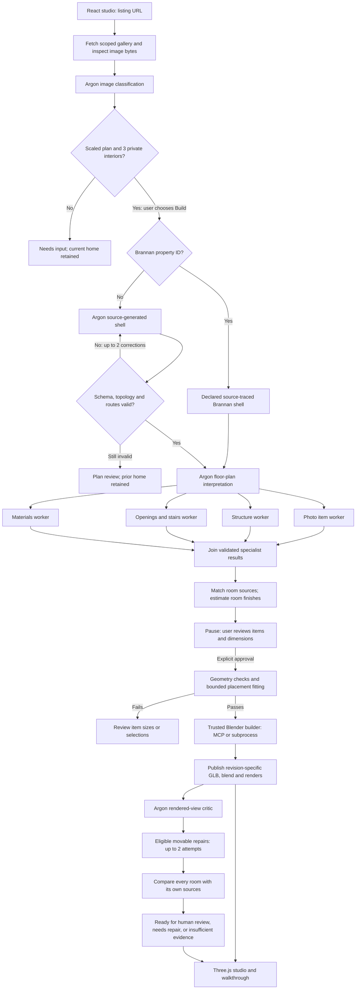

# Listing2Living architecture

Listing2Living turns listing evidence into an editable planning scene, then checks the result against geometry and source photographs. Its runtime is a **custom, multi-stage orchestration harness** in a local Node.js server. Named workers are task-specific Gemini calls; they are not separate coding agents, autonomous processes, or Google Managed Agents.

The system separates three questions:

1. **Is there enough evidence to attempt reconstruction?** A readable scaled floor plan and at least three private-home interior photographs are required.
2. **Does the proposed arrangement pass geometric checks?** Boundaries, collisions and routes are tested deterministically.
3. **Does each rendered room resemble its evidence?** Argon compares actual rendered images with matched photographs and records unresolved differences.

Passing one gate does not imply passing the next. In particular, a clear route is not evidence of visual fidelity, and a model's visual score is not measured reconstruction accuracy.

## Worked example: 200 Brannan Street, Apt 114

The demonstration's starting shell is the event-created [Brannan fixture](../shared/brannan.json), traced from the listing floor plan. It contains **13 modeled rooms across two levels**, with three route targets downstairs and six upstairs. The upper floor elevation is estimated at 2.85 metres. The fixture's historical ID, `brannan-lower-floor`, now identifies both floors.

[Curated source references](../shared/brannan-sources.json) contain 22 interior photographs and three plan references. Photos are linked to 11 of the 13 rooms; the entry and linen closets lack direct photographic coverage. The [fixed-fixture manifest](../shared/brannan-fixtures.json) adds source-informed baths, laundry and other fixed details with inferred dimensions and placements. These prepared inputs are declared evidence and implementation assets, not a claim that a live model independently recovered the entire Brannan shell.

Argon still performs live interpretation, furnishing proposals, room appearance analysis and rendered-image review. Empty listing rooms do not become evidence that suggested furniture was originally present: suggested staging and photo-observed items have different origins in the contract.

For **other Zillow property IDs**, the server does not reuse Brannan geometry or its fixed-fixture manifest. It asks Argon to reconstruct a new shell from that property's actual plan and photographs, validates it, and permits at most two correction attempts after the initial draft. The generic path can stop for plan review even after source intake succeeds.

## Runtime graph

This graph describes the implemented sequence in [the server](../server/index.ts). It is an explicit application workflow, not a general DAG execution service.



The four specialists run concurrently after plan interpretation using `Promise.allSettled`. Room-source batches, per-room appearance calls and room critics use a separate worker pool with a concurrency limit of three. The system waits for the parallel work to settle before propagating a failure.

### Stage contracts and gates

| Stage                    | Inputs                                                                               | Agent / tools                                                                                        | Output                                                                                | Gate                                                                                                        | Implementation                                                                                                     |
| ------------------------ | ------------------------------------------------------------------------------------ | ---------------------------------------------------------------------------------------------------- | ------------------------------------------------------------------------------------- | ----------------------------------------------------------------------------------------------------------- | ------------------------------------------------------------------------------------------------------------------ |
| Listing intake           | HTTPS Zillow property URL; optional same-property curated references                 | Scoped HTML extraction, allowlisted image fetches, Argon image classifier in batches of at most five | `IntakeReport`, source IDs and local image references                                 | One readable plan with a transcribed numeric dimension/scale; three readable private-home interiors         | [intake.ts](../server/intake.ts)                                                                                   |
| Shell selection          | Ready intake and property ID                                                         | Brannan fixture, or live Argon reconstruction plus deterministic validation                          | Canonical shell with rooms, walls, openings, stairs, cameras and navigation           | Generic drafts must pass schema, topology, support and route checks; initial attempt plus two corrections   | [index.ts](../server/index.ts), [intake.ts](../server/intake.ts)                                                   |
| Plan interpretation      | Shell, plan image and source notes                                                   | Argon floor-plan interpreter; schema and basis normalization                                         | `PlanInterpretation`: dimensions, confidence, evidence, uncertainties                 | Known room IDs; numeric dimensions; unsupported measurements remain inferred                                | [workflow.ts](../server/workflow.ts)                                                                               |
| Parallel specialists     | Plan, shell and selected source photographs                                          | Argon photo-item, structure, openings/stairs and materials workers                                   | Asset candidates, structural notes, opening findings and approximate colors           | Every response is parsed; a failed worker stops this build stage                                            | [index.ts](../server/index.ts)                                                                                     |
| Room evidence            | Room IDs, photographs and plan                                                       | Argon photo matching; per-room material analysis; Brannan-only fixed-fixture merge                   | Room `sourceIds`, appearance, basis; selected fixture/camera additions                | Match only known IDs; uncertain photos are not assigned; absent photos keep inferred appearance             | [rooms.ts](../server/rooms.ts), [brannan-fixtures.json](../shared/brannan-fixtures.json)                           |
| Proposal approval        | Plan interpretation and `AssetProposal[]`                                            | Human review in the studio                                                                           | Approved IDs, selected dimensions and approval mode                                   | Explicit approval before Blender; unknown/duplicate IDs and invalid dimensions rejected                     | [WorkflowReview.tsx](../src/WorkflowReview.tsx), [workflow.ts](../server/workflow.ts)                              |
| Placement fit            | Approved scene                                                                       | Deterministic `verifyScene` and bounded `suggestRepair`                                              | Arrangement plus `Verification`                                                       | All geometry checks must pass before the approval job starts Blender; no resizing to force a fit            | [verification.ts](../shared/verification.ts), [index.ts](../server/index.ts)                                       |
| Build and publish        | Approved canonical JSON                                                              | Python bridge and trusted Blender builder                                                            | Architectural GLB, editable blend file, reference image, room images and build report | Correct scene/revision, embedded GLB resources, approved furniture present in renders, room outputs present | [blender.ts](../server/blender.ts), [bridge.py](../blender/bridge.py), [build_scene.py](../blender/build_scene.py) |
| Rendered-view inspection | Actual rendered image, source photos, plan, approved proposals and geometric results | Argon visual critic                                                                                  | Revision-bound `VisualAssessment`                                                     | Evidence present, geometry passing, each score at least 70 and no major findings for a view-level pass      | [index.ts](../server/index.ts), [workflow.ts](../server/workflow.ts)                                               |
| Whole-home review        | Fresh render of every room and its matched photographs                               | Argon room critics, up to three concurrent calls                                                     | `RoomAssessment[]` and aggregate assessment                                           | Every room needs current sufficient evidence and a passing review; no average-score shortcut                | [rooms.ts](../server/rooms.ts)                                                                                     |
| Refinement               | Current findings and accepted scene                                                  | Argon movable-placement planner or room-finish worker; geometry; fresh Blender render and critique   | Accepted improvement or preserved prior scene with unresolved findings                | Separate bounded repair paths described below                                                               | [index.ts](../server/index.ts), [rooms.ts](../server/rooms.ts)                                                     |

The intake's amber **Room coverage documented** row is informational. It records that full coverage was not established at intake and does not block a ready intake from building. It remains an initial-check snapshot; later room-source links and `RoomAssessment` records provide the actual room-by-room coverage status.

## Shared state and coordinates

[shared/types.ts](../shared/types.ts) defines the contracts used by the server, plan editor, Three.js viewer, Blender builder and verification tools.

| Contract                               | Responsibility                                                                                                          |
| -------------------------------------- | ----------------------------------------------------------------------------------------------------------------------- |
| `Source` / `IntakeReport`              | Evidence identity, original URL, local image path, optional room/floor links and intake outcome                         |
| `SceneSpec`                            | Canonical rooms, walls, openings, fixed and movable objects, stairs, cameras, navigation, sources and uncertainty notes |
| `PlanInterpretation` / `AssetProposal` | Reviewable dimensions and items with confidence, evidence, origin and selection state                                   |
| `PlacementPatch`                       | Existing object ID and optional position, rotation or color; no dimensions or architecture edits                        |
| `Verification`                         | Scene revision, geometric issues and actual route points for each floor                                                 |
| `VisualAssessment` / `RoomAssessment`  | Separate model judgments, supporting evidence, recommendations and reviewed revision                                    |
| `WorkflowState` / `AppState`           | Approval phase, repair counters, active scene, build URL, events, saved-home ID and busy state                          |

Coordinates are **metres, XY on the floor, Z upward**. Object and stair positions are bounding-box centers; dimensions are width, depth and height. Rotation is radians about Z. A wall opening's offset is the distance from the wall start to the opening's center; its width extends half that distance to either side. `floorZ` identifies the support level. The Three.js viewer converts a canonical point to `(x, z, -y)`.

Stable IDs connect a source, room, object, model response and visual selection. Scene revisions connect the arrangement to its rendered artifacts and reviews. Editing furniture creates a new revision; old room reviews remain visible as stale until refreshed. Changing architecture, fixed objects or room appearance invalidates the current architectural GLB, allowing an explicitly labelled procedural preview while a new build is pending.

## Model context and response handling

[askArgon](../server/argon.ts) calls the Gemini **Interactions API**, with `gemini-4-argon` as the default model. A local configuration can override the model name; there is no automatic fallback to a different model. The runtime does not invoke Google Managed Agents.

Each call supplies its own task instructions, selected canonical JSON, evidence labels and actual image bytes. Calls are not a persistent model conversation: later stages receive explicit prior results, not an assumed hidden conversation memory. `AsyncLocalStorage` scopes saved interaction files to a property; it is application logging context, not model memory.

The wrapper accepts at most five images per call, validates PNG/JPEG/WebP bytes and sends them inline. It requests JSON, parses an object, records model ID, returned interaction ID, elapsed time, usage and output, and lets the stage-specific schema validate it. Source text is explicitly treated as evidence rather than instructions. Errors are surfaced rather than replaced with synthetic model successes.

Context is selected to fit each job. For example, room matching uses up to four photos plus a plan; room appearance uses up to three matched photos; a room critic receives its fresh render, up to two matching photos and a plan when available. Generic reconstruction includes source images, the rejected draft and related validation errors in each correction request. A guarded floor-registration helper may translate an unambiguously connected upper floor as a whole; it does not invent rotations, resize rooms or waive subsequent validation.

**Room appearance details and room-critic recommendations have no schema count limit. Appearance detail strings also have no per-string length limit.** A response with 40 or more valid entries is retained rather than rejected or truncated. String types, color formats and material categories remain validated. Model output budgets remain bounded: room appearance and finish corrections request 1,800 output tokens, room critics 2,400, and generic shell reconstruction 16,000. Other contracts still have their own bounds, such as patch counts and geometry sizes; removing descriptive-list limits did not remove those checks.

Only recognized feature tokens currently add cosmetic wall details in Blender: `feature:closet-rail` and `feature:concrete-accent-wall`. Their position in the details list does not matter. Free-form model prose is not executed as Python and does not automatically become arbitrary geometry.

## Human approval

`POST /api/build` analyzes the selected property's sources and pauses at `awaiting-approval`. It does **not** mean that Blender generation has completed or even begun. The user can inspect room dimensions, uncertainties, image references and item origins, select items and edit their estimated dimensions.

`POST /api/approve` accepts either reviewed choices or the explicit suggested shortcut. The shortcut selects three catalog proposals: sofa, desk and rug. These are labelled staging suggestions, not observed furniture. Photo-derived proposals must reference available photos and a modeled floor. Approval rejects unknown or duplicate item IDs, and approved item sizes are preserved during fitting and later repairs.

If those sizes cannot be placed while passing geometry checks, the approval job stops before Blender and asks for revised selections or dimensions. Approval permits the bounded movable-object visual loop; it does not authorize the model to change the fixed shell silently.

## Blender and Three.js have different jobs

**Blender builds the inspectable artifacts.** [server/blender.ts](../server/blender.ts) writes a canonical scene JSON file in a staging directory and invokes [bridge.py](../blender/bridge.py). In automatic transport mode, the bridge first checks the installed Blender MCP add-on's local socket on port 9876. It uses that session only if a Listing2Living ownership marker is present; otherwise it launches Blender in an isolated background subprocess. Explicit MCP mode reports an unavailable or unmanaged session as an error.

The bridge uses the add-on's socket transport; it is not a newly implemented MCP server. Both transports execute the repository's trusted [build_scene.py](../blender/build_scene.py) against validated scene data. The model does not generate arbitrary executable Blender scripts for this path. The build report records which transport ran.

Blender exports fixed architecture to GLB. Approved movable furniture is included in the editable `.blend`, overall reference render and per-room renders, but is excluded from the architectural GLB so the browser can edit furniture independently. The legacy artifact basenames `brannan.glb` and `brannan.blend` are used for every property; the enclosing scene-specific build directory isolates them.

Before publishing, the server validates the GLB container and embedded resources, checks the scene ID and revision, checks the room-render manifest, and confirms every approved movable item is represented in the render report. It then renames the staging directory to a unique published directory. A failed build does not overwrite the previous published assets.

**Three.js is the interactive studio.** [SceneViewer.tsx](../src/SceneViewer.tsx) loads the architectural GLB and draws editable procedural furniture from the canonical JSON. It supplies orbit views, floor switching, selection, route overlays, browser-view capture and a first-person walkthrough. The [plan editor](../src/PlanView.tsx) and viewer share object IDs and dimensions. Walkthrough stair traversal is a simulation, distinct from the per-floor geometric route checks; it does not certify stairs, headroom or accessibility.

## Verification and repair

### Deterministic geometry

[verifyScene](../shared/verification.ts) checks furniture footprints against the union of rooms at their support elevation, oriented furniture overlaps, walls with their modeled openings, and stair footprints with vertical overlap. It accounts for benign overlaps such as rugs beneath furniture and some tucked-chair arrangements. Fixed objects act as constraints on movable items; the verifier is not a complete structural or fixed-fixture engineering analysis.

Route search uses A* on a grid nominally spaced at 0.12 metres, with coarser spacing for exceptionally large bounds. Walkable space is reduced by half the requested clearance around obstacles and floor edges. Segment checks sample intermediate points, including when simplifying the returned route. The current generic reconstruction contract requires a clearance of **0.65 metres**. Downstairs routes begin at the entrance; upstairs routes begin at their own landing. They do not prove a continuous certified route up the staircase.

The deliberately added doorway bench is explicitly a **stress test**, not a claimed defect discovered in the source listing.

### Placement repair sequence

```mermaid
sequenceDiagram
    actor User
    participant API as Local server
    participant Check as Geometry verifier
    participant Argon
    participant Fit as Bounded placement tool
    participant Store as Scene and revision store
    User->>API: Repair current arrangement
    API->>Check: Verify accepted scene
    Check-->>API: Failed routes and geometric issues
    API->>Argon: Canonical scene plus actual failures
    Argon-->>API: Existing-object position/rotation patches
    API->>API: Validate patches; preserve sizes, floors and fixed/pinned items
    API->>Check: Test candidate
    opt Candidate still fails
        API->>Fit: Search legal nearby placements
        Fit->>Check: Test bounded candidates
        Fit-->>API: Candidate scene and actual remaining issues
    end
    alt Improvement with no previously passing route lost
        API->>Store: Commit new revision and verification
        API-->>User: All checks pass, or explicit partial improvement
    else No verified improvement
        API-->>User: Keep previous scene; show unresolved issues
    end
```

Ordinary route repair can accept a partial improvement only if it reduces errors without losing a previously passing destination. It does not mark the remaining failures green. The deterministic fitter preserves dimensions and Z positions, skips pinned/fixed items and searches candidates on the original floor. Work is bounded by 6,000 placement checks and 120 route checks across at most eight movable objects, with at most 80 valid candidate trials per object. These are computation bounds, not a guarantee that a feasible placement will be found.

### Visual loops

There are two separate refinement paths:

- **Movable-object visual repair:** after initial approval and rendering, eligible placement/appearance findings can trigger up to two automatic repair–render–inspect attempts. Patches can move, rotate or recolor existing movable, unpinned items. Geometry must pass with no route regression before a fresh render is inspected. The candidate must improve the visual assessment; otherwise the accepted scene is retained. Structural/evidence findings are carried forward because this repair cannot resolve them. The manual visual-repair endpoint shares the same attempt counter.
- **Room-finish refinement:** a user requests refinement after current room reviews exist. Argon can adjust wall/floor/ceiling colors and the floor material category for rooms with weak material scores. Existing details, sources and geometry are retained. The server renders and reviews rooms again, accepting only a higher aggregate material score with no previously passing room becoming non-passing. This path has a separate two-attempt limit.

The 70/100 visual threshold is a provisional model rubric. A room also needs a matching photo, a fresh room render, sufficient evidence and no major mismatch. Whole-home readiness requires current passing results for **every** modeled room plus passing geometry. A high average cannot mask a missing closet photo. A passing single browser view cannot replace the complete room review. If the same model judges its own proposal favorably, that remains model assessment rather than independent measured accuracy.

## Persistence, rollback and concurrent work

The server is a local single-active-home application, with serialized mutations rather than a distributed job queue. Mutations return a conflict while another job is busy. Longer intake, build and review jobs return HTTP 202; the browser polls state and displays real stage events. Mutating browser requests are restricted to the expected local origin.

Before a mutation or background job, the server snapshots the scene, workflow, artifact URL, verification, visual review, events, active property ID, intake and undo history. Unhandled failure restores that in-memory snapshot and saves the result. Some stages intentionally handle an inspection failure by keeping a successfully built scene in `needs-review`; that is distinct from a successful inspection.

Parallel work must finish settling before rollback can release the workspace lock. The four-specialist join uses `Promise.allSettled`; the room worker pool also drains in-flight workers before throwing. This prevents a late worker from continuing to update the old home's progress after the user switches homes. Persistence is queued, and the busy lock stays held until saving finishes.

| Location                                              | Contents                                                                                     |
| ----------------------------------------------------- | -------------------------------------------------------------------------------------------- |
| `runtime/state.json`                                  | Active-home recovery checkpoint, written through a temporary file and rename                 |
| `runtime/projects/<property-id>/state.json`           | That home's canonical scene, workflow, reviews, sources, artifact reference and undo history |
| `runtime/projects/<property-id>/versions/`            | Archived snapshots before rebuilds or replacement                                            |
| `runtime/projects/<property-id>/intake.json`          | The property's latest evidence-intake report                                                 |
| `runtime/projects/<property-id>/interactions/`        | Property-scoped model outputs, interaction IDs and usage metadata                            |
| `public/evidence/<property-id>/`                      | Downloaded evidence images; same-property curated files may also be reused                   |
| `public/generated/<scene-key>/build-<revision>-<id>/` | Immutable published GLB, blend, source scene, render images and build report                 |

Undo retains up to 20 scene snapshots. The active UI retains the latest 60 events; an append-only local event log also records progress. Restoring an interrupted build/review marks it for review rather than pretending that the interrupted work completed.

Rollback is not a database transaction spanning every file: previously downloaded evidence, interaction logs, archives and uniquely published candidate builds may remain on disk. The accepted scene and artifact pointer are what the workflow preserves. Runtime state, images, generated artifacts and local credentials are ignored by Git; the public repository contains the code and source-reference metadata, not the downloaded listing gallery.

## Known limits and honest interpretation

- Intake currently supports HTTPS Zillow property URLs, not arbitrary sites. It scopes the gallery to the requested property and inspects at most 30 images, retaining the beginning and end of larger galleries. A plan in an omitted middle section can be missed. Shared amenities do not count as private-home interior evidence.
- Missing scale is a real input limitation. An unscaled plan and a listing's total area do not establish dependable room dimensions. The current pipeline does not silently turn those inputs into verified metric geometry.
- Generic shell generation can still fail topology, opening, stair-support or route validation after its two corrections. It does not borrow the Brannan fixture to manufacture success. The current clearance setting is enforced as a literal in the reconstruction schema; returning another number uses a correction attempt.
- Brannan's polygon traces, vertical alignment, ceiling heights, fixture placement and many dimensions remain estimates. The source listing and plan report different total areas; that discrepancy stays in the notes. The east-bedroom photo suggests a level change that the current shell does not reproduce.
- Some existing event/plan wording says “source-traced” even on the generic source-generated branch. The actual branch in `build()` determines geometry provenance; the two paths described above are different.
- Room-source matching is model interpretation, not proof that every source assignment is correct. Missing photos, uncertain mappings, failed calls, stale revisions and unresolved appearance differences remain reviewable.
- Descriptive details can preserve more information than the procedural renderer knows how to realize. A longer list does not imply that every mentioned furnishing or architectural detail was generated.
- This implementation demonstrates the **More Dimensions render–inspect–repair loop**. It does not claim a measured million-token engineering benchmark, guaranteed arbitrary-home reconstruction, photorealistic accuracy, building-code compliance or accessibility certification.

Relevant checks are in [intake tests](../tests/intake.test.ts), [workflow tests](../tests/server-workflow.test.ts), [verification tests](../tests/verification.test.ts), [room tests](../tests/rooms.test.ts) and [workspace tests](../tests/workspaces.test.ts). The room regressions specifically preserve 40-plus descriptive entries and late feature tokens while still rejecting invalid types and preventing missing-evidence or major-mismatch failures from becoming passes.
