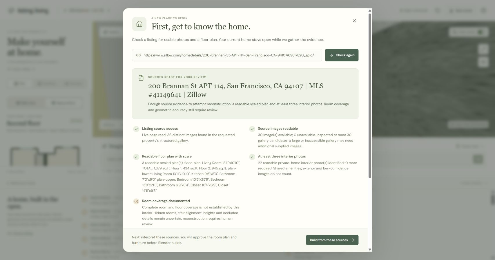
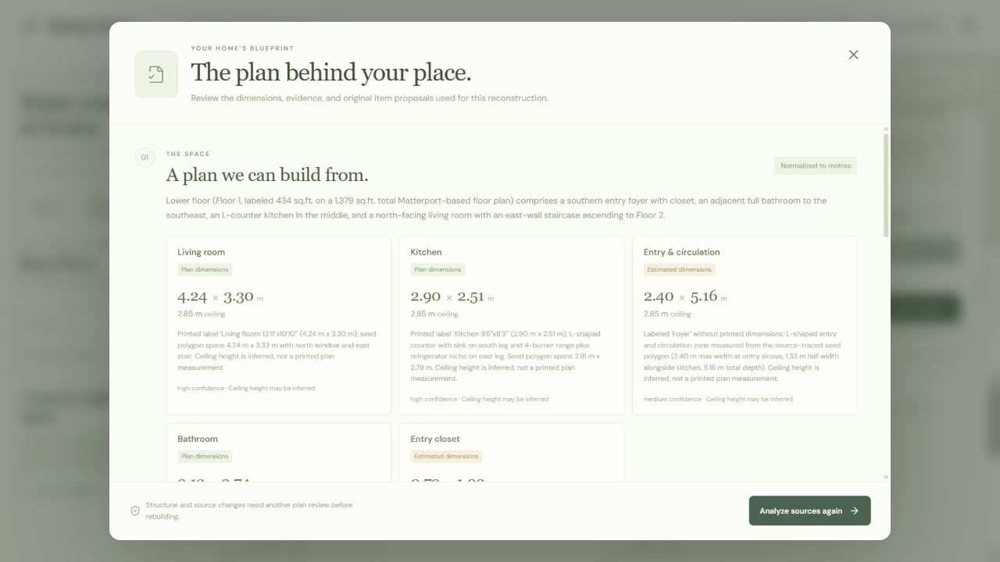
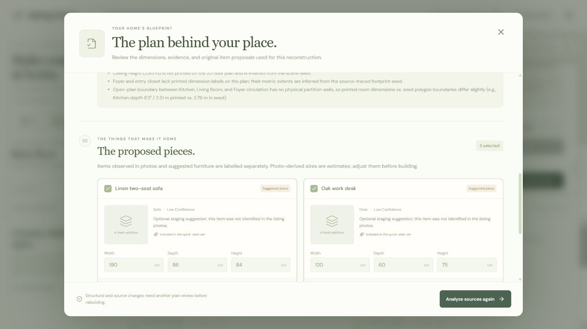
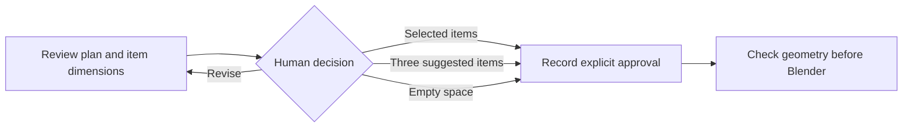
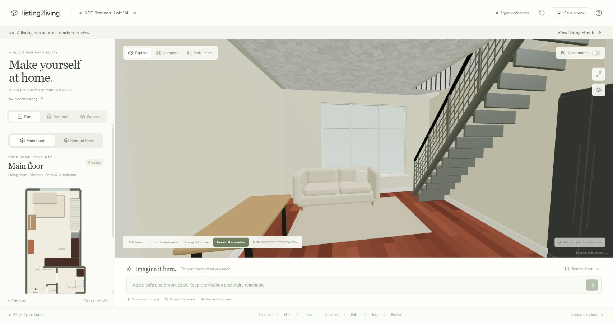
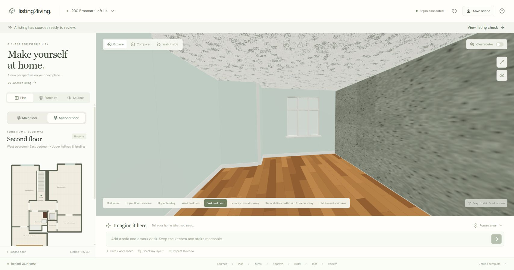
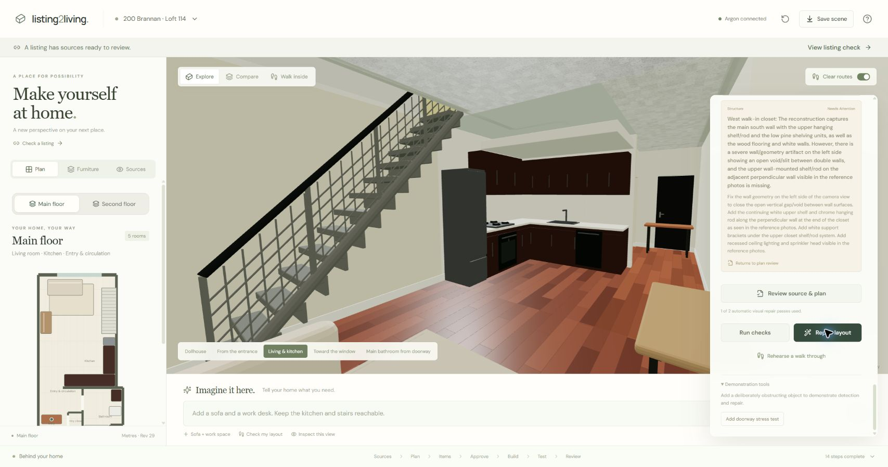
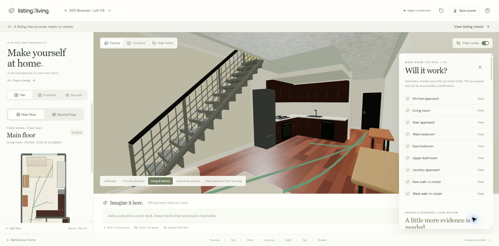
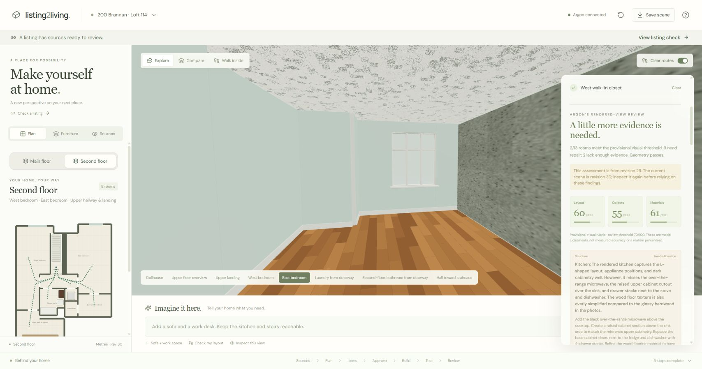
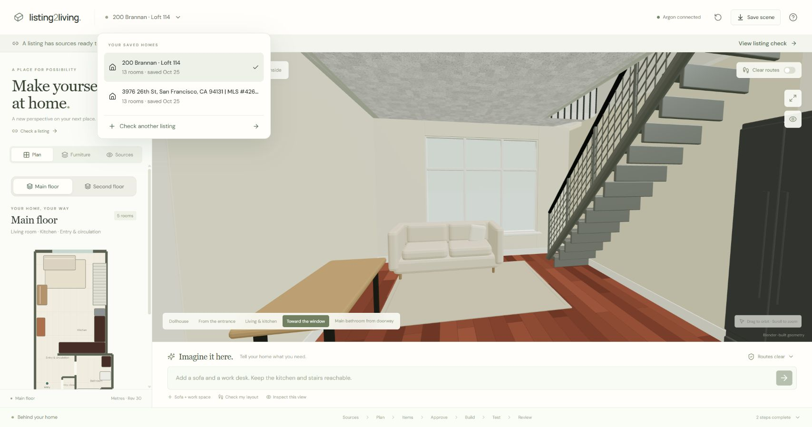

# Step inside Brannan

A visual walkthrough of **Listing2Living**, using [200 Brannan Street, Apt 114, San Francisco](https://www.zillow.com/homedetails/200-Brannan-St-APT-114-San-Francisco-CA-94107/69817820_zpid/).

The question is practical: **will your furniture fit, and can you still move through the home?** Argon interprets the evidence and critiques the result; a person approves the proposed items; Blender builds the scene; Three.js makes it explorable. Geometry checks and visual review answer different questions and keep their own results.

These are captures of the event-built prototype, including a prepared Brannan reconstruction. The stages below explain the workflow; they are not a claim that every screenshot came from one uninterrupted run. Historical revisions are identified where they matter. The screenshots show our interface and generated scene; listing photographs remain available through the original source links in the application.

## 1. Check the listing evidence

Choose **Check a listing**, paste the Brannan URL, and run **Check**. The current home stays open while the intake checks the requested property's actual images.

The gate looks for a readable floor plan with dimensions or scale, usable source images, and at least three interior photographs. It excludes unrelated gallery content such as shared amenities when deciding whether enough interior evidence exists.

**What this proves:** there is enough evidence to attempt reconstruction. It does not prove that every room is covered or that the eventual geometry will be correct. **Build from these sources** starts interpretation and leads to the approval gate.

## 2. Turn the plan into explicit dimensions

Argon produces room dimensions, evidence notes and uncertainties in metres. The builder receives a common scene description for rooms, walls, openings, stairs and objects.

_Historical Brannan review screen. It reopens the interpretation used for an earlier build; the visible “Analyze sources again” footer means approval has already happened._

The lower-floor living room, for example, has a printed plan dimension; the entry and circulation area has estimated dimensions. Ceiling height is also inferred. Expand **View original floor plan** in the application to compare those interpretations with the source before approving a new build.

**Decision:** accept the interpretation, or return to the sources when scale, room boundaries or structural assumptions are unclear. An estimated measurement stays labelled as an estimate.

## 3. Review the proposed furniture

Items identified in photographs and optional staging suggestions are labelled separately. Review each selected item's width, depth and height before generation.

_Historical proposal review. The pictured sofa and desk are explicitly labelled suggested pieces, not objects claimed to have been identified in the listing photographs. This capture contains the application's placeholder illustrations._

The Brannan shortcut offers three suggested items. During an editable approval step, you can change dimensions, select only some items, or deselect everything to build an empty space. The editable controls become a saved record after approval.

## 4. Approve before Blender starts

The plan and item review above form the human decision point. Blender waits while the workflow is **awaiting approval**.

| Choice in the approval panel      | Result                                                              |
| --------------------------------- | ------------------------------------------------------------------- |
| **Approve … items & build**       | Build with the selected items and the dimensions you reviewed.      |
| **Use 3 suggested items**         | Approve the displayed quick-start set with its proposed dimensions. |
| **Approve empty space & build**   | Build the shell without selected movable furniture.                 |
| Revisit the source interpretation | Resolve structural or source questions before rebuilding.           |

The screenshots in stages 2–3 show the saved review after this decision, so their footer differs from the active approval controls listed here. The prototype does not silently treat an unapproved proposal as a completed home.

## 5. Build, arrange and walk through both floors

Blender creates the architecture and renderable scene. The browser displays the exported architecture and interactive furniture using Three.js. The floor plan and 3D view share object identities and dimensions.

Select a piece on the plan or in the scene to move, rotate or recolor it. Use **Main floor** and **Second floor** to explore the corresponding level.

Choose **Walk inside** for a first-person view:

| Control                        | Action                    |
| ------------------------------ | ------------------------- |
| W / S                          | Move forward / backward.  |
| A / D                          | Strafe left / right.      |
| Left / right arrows            | Turn.                     |
| Up / down arrows or mouse drag | Look up / down or around. |
| Walk onto the staircase        | Move between floors.      |
| Escape                         | Return to orbit controls. |

**What this proves:** the reconstruction is an interactive scene, rather than an image of a proposed room. The staircase is traversable, but the route checker evaluates same-floor paths from each floor's starting point; it does not certify a complete stair journey.

## 6. Make a real layout failure visible

Open **Check my layout**. Under **Demonstration tools**, choose **Add doorway stress test**. This deliberately adds an obstructing bench so the test has a known, visible failure to detect.

_Recorded revision 29. The bench obstructs the entrance; the corresponding geometry check reported three blocked routes: kitchen approach, living room and stair approach. This screenshot's right panel is scrolled to earlier visual findings, so the blocked-route count is not visible in the capture itself._

This is an explicitly labelled demonstration failure, not a claim that the original listing contained an obstruction. The route result is computed from the scene geometry.

## 7. Repair, then test the result again

Choose **Repair layout**. The agent proposes a new placement, and the geometry checks run again before a successful result is accepted.

_Recorded revision 30, after the real repair. All nine displayed routes are clear, including the three that were blocked. The before/after captures omit processing wait time._

The green lines are calculated paths. The configured clearance is **65 cm**: useful for this planning demonstration, not a building-code or accessibility certification. Furniture repair preserves fixed architecture and approved item sizes.

## 8. Inspect each rendered room against its evidence

Open **Sources**, choose a floor and room, then inspect the room's review. Blender produces a room-specific render; Argon compares it with that room's available source photographs and reports concrete differences in layout, objects and finishes.

For the complete paired view, open a room's comparison in the running application. The original photograph and reconstructed render appear together, with their source labels and render revision. This repository guide does not reproduce the listing photographs.

The recorded **revision 28** review covered 13 rooms:

| Review status          | Rooms | Meaning                                                                |
| ---------------------- | ----: | ---------------------------------------------------------------------- |
| Ready for human review |     2 | Passed the prototype's review rubric; still needs a person's judgment. |
| Needs repair           |     9 | Concrete differences remained.                                         |
| Insufficient evidence  |     2 | Entry and linen closets had no direct room photographs.                |

One important finding was the east bedroom's raised floor area: the source suggests a level change that the current shell does not reproduce. That structural difference stays open for human review. **Refine room finishes** can attempt supported appearance corrections, then render and review again; it cannot silently resolve missing evidence or redesign the structure.

**Keep the two checks separate:** the room review above belongs to revision 28. Clear routes at revision 30 do not mean those earlier visual findings were fixed or re-reviewed. A fresh room review is required to assess a changed scene. Visual scores are an uncalibrated model rubric, not a measured percentage of realism.

## 9. Keep each home and its evidence together

Open the property name in the top bar to see saved homes. Selecting one restores its own scene, sources, approval state and reviews.

Checking another listing does not replace the open home. A new property must pass its own evidence gate and reconstruction validation; it cannot quietly reuse the Brannan scene. Saved state and generated assets are local to the demonstration machine. The current adapter supports Zillow property URLs; arbitrary websites are not supported.

## A three-minute click path

Prepare the Brannan scene beforehand and identify it as a prepared, event-built reconstruction. Keep live model and builder events visible in **Behind your home**. A complete source-to-build run can take longer than the pitch; do not describe a cached result as a fresh live call.

| Time      | Click and show                                            | Point to make                                                                                              |
| --------- | --------------------------------------------------------- | ---------------------------------------------------------------------------------------------------------- |
| 0:00–0:20 | Brannan selected → listing check → evidence results       | “We check whether there is enough evidence to attempt this home.”                                          |
| 0:20–0:45 | Review source and plan → dimensions → proposed items      | “Measurements carry evidence and uncertainty. A person approves the pieces before building.”               |
| 0:45–1:05 | Main floor → Second floor → Walk inside                   | “The same scene drives the plan, the interactive home and the checks.”                                     |
| 1:05–1:50 | Check my layout → Add doorway stress test → Repair layout | “A real obstruction fails the route check. A proposed repair must pass another check.”                     |
| 1:50–2:35 | Sources → room comparison → unresolved finding            | “Argon inspects the rendered result. Missing photos cannot pass, and structural differences stay visible.” |
| 2:35–3:00 | Saved-home menu → return to Brannan → main view           | “Each home keeps its own evidence. Listing2Living: step inside your next home.”                            |

If a live repair is still running, show its actual status and identify any already-completed result as a prior run. The [demo guide](DEMO.md) includes presentation notes; the [README](../README.md) covers setup and the implementation's scope.

## What remains uncertain

The Brannan footprint was traced from supplied floor-plan evidence during the event. Ceiling heights, upper-floor elevation, some fixture sizes and placements remain inferred. The listing's area and plan's area disagree. Two rooms lack direct photographs, and the revision 28 visual review leaves substantial work unresolved. The project is an editable planning prototype with a visible verification loop, not a measured digital survey or a completed reconstruction of every detail.
