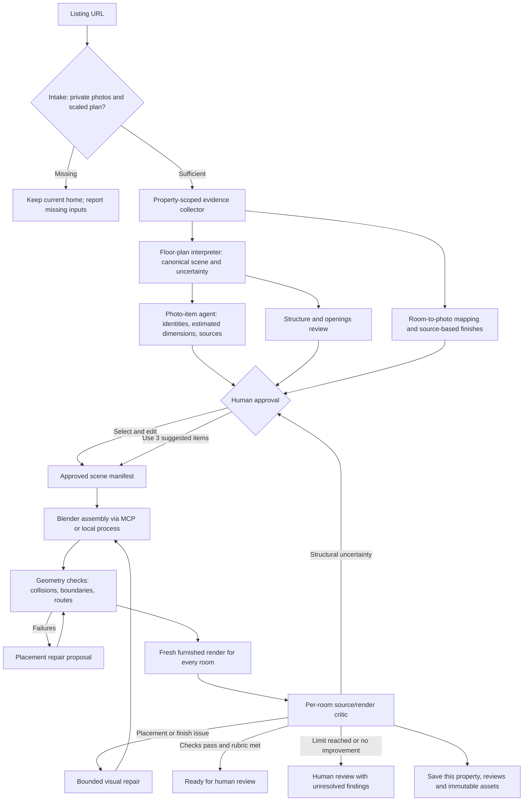

# V1 plan: evidence → approval → reconstruction → verified review

## Product decision

The user is a prospective resident trying to understand whether a home and a furniture arrangement work in practice. The prototype should answer that through an explorable reconstruction with explicit uncertainty, traceable source evidence, and working circulation tests.

The hackathon track is **More Dimensions**: generate a world, render it, inspect the result, and improve it in a real loop. The visible result is the home itself; the agent workflow is supporting evidence.

## Orchestration

## Agent responsibilities and contracts

| Agent or tool             | Inputs                                                   | Reviewable output                                                                        | Boundary                                                                |
| ------------------------- | -------------------------------------------------------- | ---------------------------------------------------------------------------------------- | ----------------------------------------------------------------------- |
| Evidence collector        | Supported listing URL                                    | Image files, source IDs, URL and cache provenance                                        | No pretend browser extraction if the page is blocked                    |
| Floor-plan interpreter    | Plan image, source-traced seed                           | Room dimensions, canonical polygons, openings, stairs, scale explanation and uncertainty | Preserve plan-derived footprint; distinguish measurements and estimates |
| Structure/opening workers | Plan, photos and interpretation                          | Reviewed heights, openings/stair observations                                            | Conflicting structural evidence returns to review                       |
| Photo-item agent          | Photos plus room dimensions                              | Item identity, XYZ size estimate, placement, color, source IDs, confidence and reasoning | Suggested furniture is labelled as suggested                            |
| Human gate                | Plan summary and item proposals                          | Selected items and accepted/edited sizes                                                 | No Blender generation until approval or explicit shortcut               |
| Blender builder           | Approved canonical scene                                 | Editable `.blend`, architectural GLB, furnished reference render and build report        | Deterministic script; model never supplies arbitrary executable Python  |
| Geometry verifier         | Current scene                                            | Collision, containment and reachability results                                          | Numeric geometry, not an LLM opinion                                    |
| Placement repair agent    | Failed checks and scene                                  | Restricted move/rotate/finish patches                                                    | Fixed geometry and approved dimensions stay intact                      |
| Visual critic             | Fresh furnished render, source photos and verified scene | Scores, concrete findings, affected IDs and recommended next action                      | Camera differences and missing evidence are explicit                    |
| Coordinator               | All results                                              | Revision history, real events and bounded iteration                                      | Failed actions preserve previous accepted artifacts                     |

## Shared scene contract

`shared/types.ts` is the contract. Distances are metres. The floor lies in XY and height is Z. Furniture positions are bounding-box centres; rotations are radians about Z. Opening offsets are measured to the opening centre along a wall. Stable IDs link each object across plan, browser, Blender, source annotations and tests.

The demo starts with a traced Brannan footprint. Argon actually reads the plan and photos, reviews that seed and proposes assets. V1 must not claim that every polygon was autonomously recovered from an arbitrary web listing.

## Approval experience

The approval screen shows room dimensions first, then a concise card per proposed asset. Each card has an item name, evidence image/reference, whether it was observed or suggested, estimated width/depth/height, confidence and explanation. A person can deselect items and change dimensions before approving.

“Use three suggested items” is an explicit shortcut through this gate. The resulting items remain labelled as suggestions rather than recovered property assets. Approvals and the selected mode are recorded.

## Repair and readiness rules

1. Check all target routes, furniture overlap and boundary containment on the actual scene revision.
2. Ask Argon for a restricted placement repair if checks fail. Test its proposal. If a deterministic placement tool is needed, label that tool in the event stream.
3. Never accept a repair that blocks a previously reachable destination. Preserve approved sizes and fixed architecture.
4. Render the furnished accepted scene, then send that fresh image and source photos to Argon.
5. Use a provisional 0–100 rubric for layout consistency, object consistency and material consistency, with an initial threshold of 70 in each category. These scores are model judgements, not calibrated accuracy metrics.
6. Mark ready for human review only when geometry passes and every room has a current render, matched source evidence, passing rubric scores and no major mismatch. A strong single-view score cannot accept the whole home.
7. A visual repair may adjust movable placements and finishes. It must pass geometry again and receive a fresh render review. Cap automatic attempts at two and stop on no improvement.
8. Structural discrepancies, missing evidence and unresolved findings remain visible for a person. Do not force a green status to satisfy the demo.

## V1 scope

Included: one supported listing, lower foyer/kitchen/living and upper bedrooms/hallway/bathroom/laundry/closets, source comparison, human approval, procedural furnishings, linked 2D/3D editor, live Argon calls, actual Blender assembly, floor-aware route tests, bounded repair, revision-aware visual findings, scene export and saved local artifacts. A level selector synchronizes plan and 3D view. First-person controls use WASD movement, arrow-key or mouse-drag look, and smooth stair elevation; Escape restores orbit controls.

Additional Zillow property URLs now have live intake and source-derived reconstruction with strict validation. Other website adapters, reliable reconstruction of every complex multi-floor plan, exact measurement, photogrammetry, Gaussian splat training, retailer asset scraping, photorealistic object recovery, cloud hosting of Blender and automatic structural renovation remain outside this prototype's proven scope.

The second-floor extension preserves the saved lower-floor arrangement, adds source-traced rooms at an inferred 2.85 m elevation, invalidates old rendered-review freshness, and rebuilds the architectural artifact. Existing furniture edits and repairs preserve their original floor. Navigation checks are per level; they are not a certification of staircase safety or accessibility. The expanded gallery matches photos to 11 of 13 rooms; entry and linen closets still lack direct photographs. Structural differences such as the east bedroom's raised area remain review findings.

## Acceptance evidence

- The source analysis stops at approval and does not call Blender early.
- The approved object IDs and dimensions reach Blender and the browser unchanged.
- A new build produces a fresh matching render; stale artifacts cannot count as a current review.
- The baseline has reachable destinations. A deliberately labelled obstruction fails; repair restores reachability without changing fixed items or furniture sizes.
- The visual critic receives actual image bytes and surfaces its recommendations.
- The browser exposes the real workflow, including cached inputs, failures and unresolved results.
- Type checks, production compilation and meaningful geometry/workflow tests pass.
- The repository is public, contains no credentials or downloaded property imagery, and identifies original contributions.

## Three wow moments

1. **Evidence becomes space:** approve photo-backed item cards, then see the room and approved furnishings assembled.
2. **It catches an arrangement that does not work:** a clear route turns blocked, the repair agent moves the obstruction, and a route animation demonstrates the result.
3. **It can criticise its own output:** compare source and render, show a concrete recommendation, and send an eligible issue through a real repair/render/review cycle.
